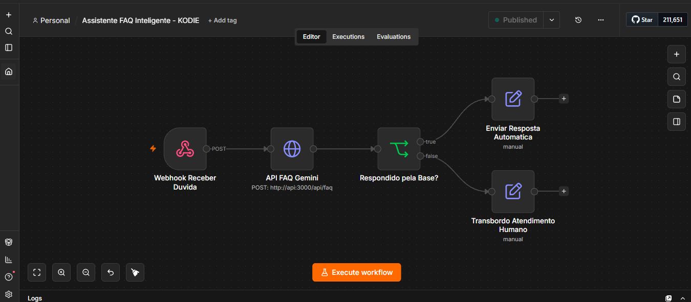
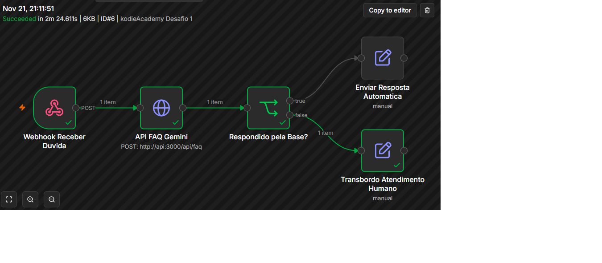

# Assistente Inteligente de Perguntas Frequentes (FAQ) — Desafio Técnico KODIE

Solução de atendimento automatizado que integra **Node.js (Express)**, **Google Gemini API** e **n8n** em ambiente **Docker** para interpretar dúvidas de clientes, consultar uma base de conhecimento interna e decidir automaticamente entre responder ao cliente ou realizar o transbordo para um atendente humano.

---

## 1. Apresentação da Ideia

A ideia surgiu da necessidade comum em pequenas e médias empresas de agilizar o atendimento inicial sem perder a confiabilidade das informações. Em vez de deixar um atendente humano respondendo repetidamente às mesmas perguntas sobre prazos, pagamentos e trocas, a proposta utiliza Inteligência Artificial como uma camada de triagem e resposta fundamentada, acionada automaticamente via webhook.

## 2. Problema Escolhido

**Cenário 4.4 — Assistente de Perguntas Frequentes:**  
Uma empresa recebe diariamente dezenas de mensagens com dúvidas recorrentes (formas de pagamento, prazo de entrega, política de devolução, emissão de nota fiscal e horário de funcionamento). Responder manualmente gera lentidão no suporte, enquanto respostas genéricas sem controle podem gerar informações incorretas ao cliente.

## 3. Solução Proposta

A solução combina uma API REST em Node.js com um fluxo de automação no n8n:
1. O **n8n** recebe a pergunta do cliente através de um **Webhook** (`POST`).
2. O fluxo envia os dados para a **API Express**, que consulta o modelo **Google Gemini** injetando um prompt estruturado com a base oficial da empresa (`faqBase.js`).
3. A IA analisa se a dúvida pode ser respondida exclusivamente com os dados fornecidos e retorna um **JSON estruturado** contendo a resposta e a flag booleana `precisa_humano`.
4. De volta ao **n8n**, um node condicional (`IF`) avalia o retorno:
   - **Se `precisa_humano` for `false`:** envia a resposta automática diretamente ao cliente.
   - **Se `precisa_humano` for `true`:** encaminha o atendimento para a fila de suporte humano com os dados da solicitação.

## 4. Tecnologias Utilizadas

- **Back-end:** Node.js (v20) e Express
- **Inteligência Artificial:** Google Gemini API (`@google/genai` com *Structured Outputs* em JSON)
- **Automação:** n8n (Webhook, HTTP Request, IF e Edit Fields)
- **Infraestrutura e Containers:** Docker e Docker Compose

## 5. Funcionamento do Sistema

### Fluxo de Dados
1. **Entrada (`Webhook`):** Recebe um JSON no formato `{"cliente": "Nome", "pergunta": "Texto da dúvida"}`.
2. **Processamento (`POST /api/faq`):** A API valida o payload, aplica o *System Prompt* com regras anti-alucinação e força o esquema de saída JSON do Gemini:
   ```json
   {
     "encontrou_resposta": true,
     "tema": "Troca e Devolução",
     "resposta": "Olá, Mariana! Você tem até 7 dias corridos...",
     "precisa_humano": false
   }
   ```
3. **Roteamento (`IF` + `Edit Fields`):** O n8n direciona o fluxo para o ramo **Verdadeiro** (`respondido_automaticamente`) ou **Falso** (`encaminhado_atendente`).

### Documentação Visual do Fluxo (n8n)

#### 5.1 Fluxo Completo
Visão geral dos 5 nodes conectados no editor do n8n (Webhook, HTTP Request, IF e nós de saída).


#### 5.2 Execução Bem-sucedida
Histórico de execuções concluídas com sucesso na aba *Executions*.


#### 5.3 Configuração dos Nodes
Configurações internas do Webhook, requisição HTTP para a API Express (`http://api:3000/api/faq`) e regra condicional no node `IF`.


#### 5.4 Resultados Processados (JSON da IA)
Saída estruturada retornada pelo Gemini e processada pelo fluxo.


---

## 6. Como Executar o Projeto

### Pré-requisitos
- [Docker](https://www.docker.com/) e Docker Compose instalados.
- Uma chave de API válida do [Google AI Studio (Gemini)](https://aistudio.google.com/).

### Passo a passo com Docker Compose

1. **Clone o repositório:**
   ```bash
   git clone https://github.com/Samueelljr/kodie-assistente-faq-ia.git
   cd kodie-assistente-faq-ia
   ```

2. **Configure as variáveis de ambiente:**
   Crie um arquivo `.env` na raiz do projeto baseado no `.env.example`:
   ```bash
   cp .env.example .env
   ```
   Edite o `.env` e insira sua chave da API Gemini:
   ```env
   PORT=3000
   GEMINI_API_KEY=sua_chave_api_aqui
   ```

3. **Suba os containers (API + n8n):**
   ```bash
   docker compose up --build -d
   ```

4. **Importe e publique o workflow no n8n:**
   - Acesse `http://localhost:5679` no navegador e crie seu acesso local.
   - Crie um novo workflow, clique no menu **⋮ → Importar de arquivo...** e selecione `n8n/workflow_faq.json`.
   - Clique em **Publicar** no canto superior direito.

5. **Teste os endpoints via cURL:**

   **Cenário 1 — Pergunta coberta pela base (Resposta Automática):**
   ```bash
   curl -X POST http://localhost:5679/webhook/faq-duvidas \
     -H "Content-Type: application/json" \
     -d '{"cliente": "Mariana", "pergunta": "Qual o prazo para devolver um produto por arrependimento?"}'
   ```

   **Cenário 2 — Pergunta fora da base (Transbordo Humano):**
   ```bash
   curl -X POST http://localhost:5679/webhook/faq-duvidas \
     -H "Content-Type: application/json" \
     -d '{"cliente": "Carlos", "pergunta": "Quero fechar uma parceria comercial para revender os produtos de vocês."}'
   ```